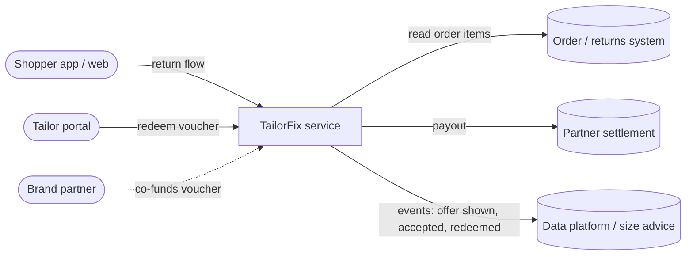
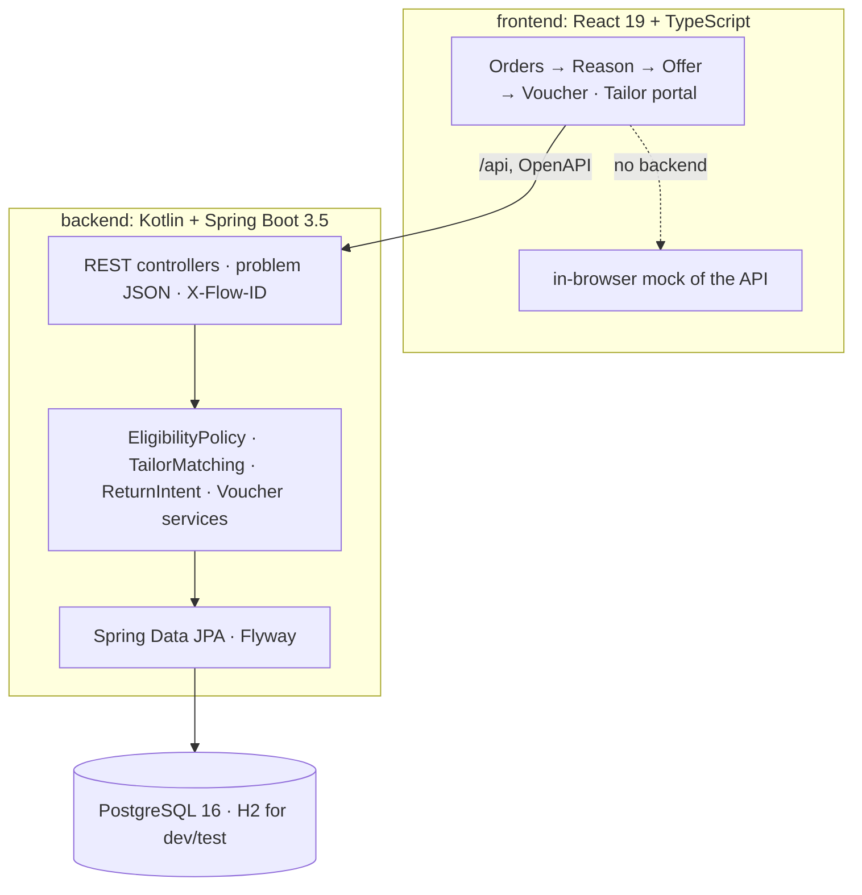
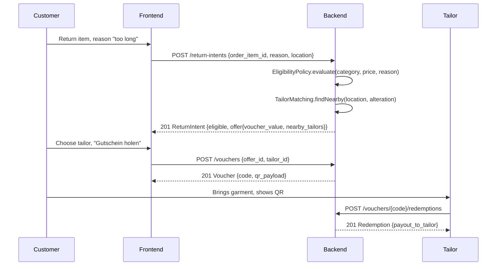

# Architecture

TailorFix is designed as one bounded context that would plug into Zalando's return flow. The prototype runs stand-alone with demo data.

## Context

In production the "order / returns system", "partner settlement" and the data platform are Zalando-internal services reached over REST (OpenAPI) and events (Kafka). In the prototype they are replaced by seeded tables and log lines.

## Containers in this repository

## Request flow

## Domain model

- `OrderItem` (seed): what the customer bought; category and price drive eligibility.
- `ReturnIntent`: the customer's return attempt with reason, location and the decision (`eligible`, `rejection_reason`).
- `TailorFixOffer`: alteration type, voucher value, estimated return cost / saving / CO₂, `requires_tailor_check`, expiry.
- `Tailor`: certified partner with services, coordinates, turnaround.
- `Voucher`: code, value, brand share, status `ISSUED → REDEEMED | EXPIRED`.

All rules sit in `domain/EligibilityPolicy.kt` and are parameterised in `application.yml` (`tailorfix.economics`, `tailorfix.matching`).

## What a production version would add

- **Authentication and authorisation (deliberately absent in the prototype):** customers act inside their Zalando session, so a return intent is bound to the customer who owns the order item; tailors sign in to the partner portal (OAuth2 client per shop) and may only redeem vouchers issued to their own `tailor_id`; voucher lookup and redemption are rate-limited. The prototype exposes these endpoints openly so the click-dummy and the tailor portal can be demonstrated without accounts.
- Integration with the real return flow (eligibility call before the return label is generated) and with partner settlement.
- Tailor onboarding and certification workflow, standard price list per job, SLAs, ratings, dispute handling.
- Fraud and abuse controls: caps per customer, garment must be unworn, voucher bound to the order item, tailor confirms the garment matches.
- Already in the prototype: a voucher can only be issued at a certified tailor that offers the alteration (422 otherwise), one voucher per offer is enforced by a unique index, and redemption uses optimistic locking so a double scan cannot pay out twice (both answer 409).
- Events on Kafka for the data platform (offer shown / accepted / redeemed, alteration measurements) feeding size advice.
- Kubernetes deployment behind Skipper, PostgreSQL via the Zalando Postgres Operator, OpenTelemetry tracing with `X-Flow-ID` as correlation id.
